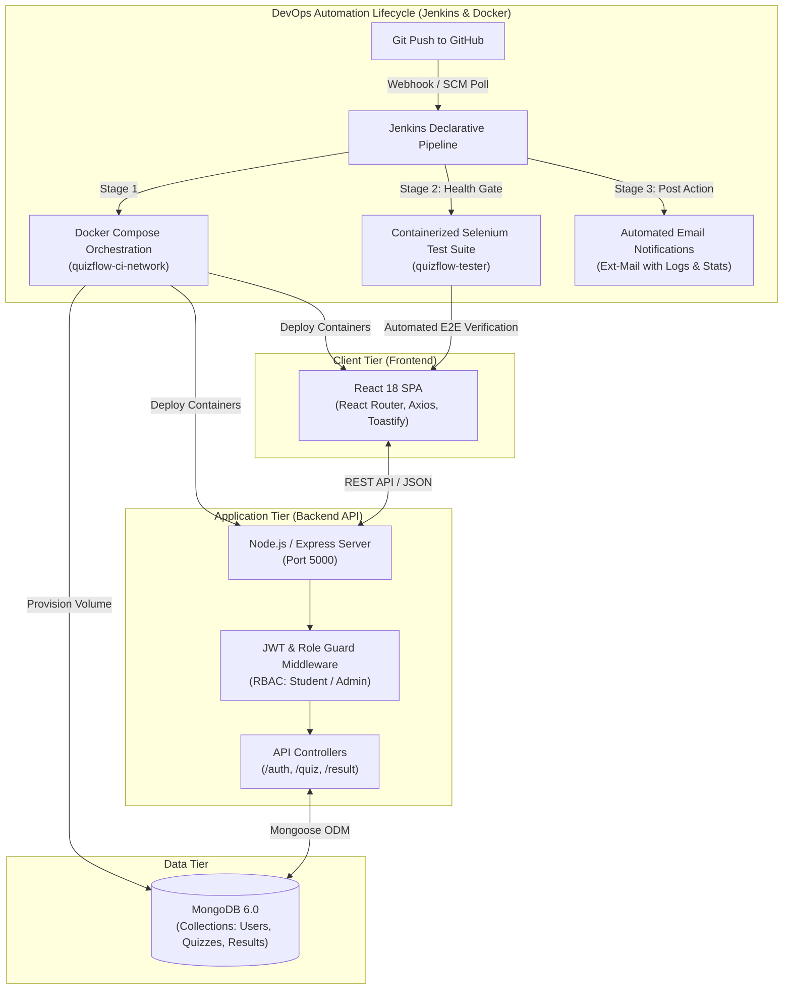

# AssessOps (formerly QuizFlow) 🚀
### Enterprise Full-Stack Assessment Platform with Automated Jenkins CI/CD & Docker Orchestration

[](https://nodejs.org/)
[](https://react.dev/)
[](https://expressjs.com/)
[](https://www.mongodb.com/)
[](https://www.docker.com/)
[](https://www.jenkins.io/)
[](https://www.selenium.dev/)
[](https://jwt.io/)

---

## 📌 Executive Summary

**AssessOps** is an end-to-end, multi-tier Computer-Based Testing (CBT) and online examination platform built using the **MERN** stack (MongoDB, Express, React, Node.js) and engineered with a production-grade **DevOps CI/CD lifecycle**. 

Beyond full-stack functionality—such as Role-Based Access Control (RBAC), real-time timed test delivery, automated grading, and an administrative assessment studio—the core strength of this project lies in its **infrastructure and release engineering**:
- **Automated Declarative CI/CD**: Fully orchestrated build, deployment, and verification via a **Jenkins Pipeline**.
- **Containerized Micro-Architecture**: Multi-container Docker composition (`docker-compose`) isolating web services, application runtime, and database persistence.
- **Automated Containerized QA**: Headless **Selenium E2E automation suite** packaged inside an isolated test container verifying application health post-deployment.
- **Dynamic Build Telemetry & Alerting**: Real-time test log parsing and dynamic automated email dispatch reporting passed/failed test status.

---

## 🏗️ System Architecture

AssessOps follows a micro-service inspired, decoupled 3-tier architecture with an automated deployment and testing pipeline.

### High-Level Architecture Diagram



---

## ⚙️ Key Technical Features

### 🎓 1. Student Examination Engine
- **Role-Restricted Student Dashboard**: View active, published quizzes and personal historical performance metrics.
- **Timed Assessment Interface**: Real-time countdown timer with automated auto-submission upon expiration.
- **Instant Grading Engine**: Server-side answer evaluation preventing client tampering, immediate score calculation, and percentage breakdown.
- **Result Archive**: Detailed test review tracking scores, submission timestamps, and pass/fail indicators.

### 🛡️ 2. Admin Assessment & Analytics Studio
- **Role-Based Access Control (RBAC)**: Secure access enforcement separating administrative operations from candidate interfaces.
- **Quiz Authoring Suite**: Dynamic question bank authoring with multi-choice validations (strictly enforced 4-option schema and 0-indexed answer verification).
- **Publish / Archive Controls**: Toggle quiz visibility to candidates on-demand.
- **Global Assessment Analytics**: View, audit, and inspect test performance and submissions across all candidates.

### 🚀 3. DevOps, CI/CD & Reliability Engineering
- **Infrastructure as Code (IaC)**: Multi-container orchestration defined via `docker-compose.jenkins.yml` with isolated internal bridge networking (`quizflow-ci-network`) and named persistent volumes.
- **Declarative Jenkins Pipeline (`Jenkinsfile`)**:
  - **Stage 1 (Test Suite Fetch)**: Dynamically clones the test repository (`quizflow-automation`) straight into the Jenkins workspace.
  - **Stage 2 (Idempotent Teardown)**: Gracefully terminates preceding staging deployments (`docker compose down --remove-orphans`).
  - **Stage 3 (Zero-Downtime Deployment)**: Builds images and launches frontend, backend, and database containers with a cold-start stabilization grace period.
  - **Stage 4 (Containerized Regression Testing)**: Builds and runs a headless **Selenium automated testing container** directly against the live environment.
  - **Post Actions (Automated Telemetry)**: Parses test metrics (`passed`, `failed`, `total`) via regex and emails full execution logs to stakeholders via Jenkins `emailext`.

---

## 🛠️ Technology Stack

| Domain | Technology / Tool | Purpose in Project |
| :--- | :--- | :--- |
| **Frontend** | React 18, React Router v6 | Single Page Application (SPA), client-side routing, and responsive UI |
| **State & Auth** | Context API, Axios | Global session management, HTTP communication, and Bearer token injection |
| **Backend** | Node.js, Express.js | High-throughput asynchronous RESTful API server |
| **Database** | MongoDB 6.0, Mongoose ODM | Document-oriented data storage with schema validation & indexing |
| **Security** | JSON Web Tokens (JWT), Bcrypt.js | Stateless authentication, session encryption, and salted password hashing |
| **Containerization** | Docker, Docker Compose | Service encapsulation, cross-platform reproducibility, and local cloud parity |
| **CI/CD Automation**| Jenkins (Declarative Pipeline) | Continuous Integration, continuous deployment orchestration, and pipeline health gates |
| **Automated Testing**| Selenium WebDriver, Python/Docker | Headless End-to-End (E2E) browser regression testing |
| **Alerting** | Jenkins Email-Extension Plugin | Dynamic test report transmission with attached build logs |

---

## 📁 Repository Structure

```text
quizflow/
├── backend/                       # REST API Services
│   ├── middleware/
│   │   └── auth.js                # JWT validation & RBAC authorization guards
│   ├── models/
│   │   ├── Quiz.js                # Assessment & question schema definitions
│   │   ├── Result.js              # Submission & grading history schema
│   │   └── User.js                # User identity & role definition schema
│   ├── routes/
│   │   ├── auth.js                # Authentication endpoints (Register/Login/Me)
│   │   ├── quiz.js                # Quiz CRUD & publish management endpoints
│   │   └── result.js              # Scoring, submission & review endpoints
│   ├── .env                       # Backend runtime configuration
│   ├── package.json               # Backend dependencies & scripts
│   └── server.js                  # Express initialization & DB connection
│
├── frontend/                      # Client Application
│   ├── public/                    # Static assets & HTML template
│   ├── src/
│   │   ├── components/            # Reusable UI modules (Navbar, etc.)
│   │   ├── context/
│   │   │   └── AuthContext.js     # React Context for authentication state
│   │   ├── pages/                 # Route views (AdminDashboard, TakeExam, Login, etc.)
│   │   ├── App.js                 # App root with Route definitions
│   │   └── index.js               # React DOM entry point
│   └── package.json               # Frontend dependencies & build scripts
│
├── Jenkinsfile                    # Declarative multi-stage Jenkins CI/CD pipeline
├── docker-compose.jenkins.yml     # Multi-container orchestration specification
├── .gitignore                     # Git tracking exclusions
└── README.md                      # Engineering documentation
```

---

## 🔌 API Reference Guide

### 🔐 Authentication (`/api/auth`)
| Method | Endpoint | Access | Description |
| :--- | :--- | :--- | :--- |
| `POST` | `/api/auth/register` | Public | Register a new user (`name`, `email`, `password`, `role`) |
| `POST` | `/api/auth/login` | Public | Authenticate credentials and receive signed JWT |
| `GET` | `/api/auth/me` | Authenticated | Retrieve current user profile and role details |

### 📝 Quiz Management (`/api/quiz`)
| Method | Endpoint | Access | Description |
| :--- | :--- | :--- | :--- |
| `GET` | `/api/quiz` | Authenticated | Fetch available quizzes (Published only for students; all for admin) |
| `GET` | `/api/quiz/:id` | Authenticated | Retrieve quiz metadata and questions |
| `POST` | `/api/quiz` | Admin Only | Create a new quiz with questions, options, and answer keys |
| `PUT` | `/api/quiz/:id` | Admin Only | Modify an existing quiz |
| `DELETE` | `/api/quiz/:id` | Admin Only | Permanently delete a quiz |

### 📊 Results & Grading (`/api/result`)
| Method | Endpoint | Access | Description |
| :--- | :--- | :--- | :--- |
| `POST` | `/api/result/submit` | Student | Submit exam responses, calculate scores, and generate result record |
| `GET` | `/api/result/my-results` | Student | Retrieve test history for the authenticated student |
| `GET` | `/api/result/all` | Admin Only | Retrieve aggregated exam results across all candidates |
| `GET` | `/api/result/:id` | Authenticated | Fetch breakdown of an individual test submission |

### 💓 Health Check
| Method | Endpoint | Access | Description |
| :--- | :--- | :--- | :--- |
| `GET` | `/api` | Public | Liveness probe returning API operational status |

---

## 🚦 Getting Started & Local Deployment

### Option A: Quickstart via Docker Compose (Recommended)

To spin up the entire production-like cluster (MongoDB, Backend, and Frontend) in one command:

```bash
# Clone the repository
git clone https://github.com/M-Afaq-Bhatti/quizflow.git
cd quizflow

# Launch all services via Docker Compose
docker compose -f docker-compose.jenkins.yml up -d --build
```

Access points:
- **Frontend Web UI**: `http://localhost:3000`
- **Backend API**: `http://localhost:5000`
- **Database (MongoDB)**: `localhost:27018`

---

### Option B: Local Development Setup (Manual)

#### Prerequisites
- **Node.js**: v18.x or later
- **npm**: v9.x or later
- **MongoDB**: Local daemon running on port `27017` or a MongoDB Atlas URI

#### 1. Backend Setup
```bash
cd backend
npm install

# Create or verify .env
# PORT=5000
# MONGO_URI=mongodb://localhost:27017/quizflow
# JWT_SECRET=your_jwt_secret_key_here

npm start
# Server listens on http://localhost:5000
```

#### 2. Frontend Setup
```bash
cd ../frontend
npm install
npm start
# Client application opens on http://localhost:3000
```

---

## 🔄 CI/CD Pipeline Execution Details

The repository includes a battle-tested **Jenkins Declarative Pipeline** configured for continuous deployment and testing:

```groovy
pipeline {
    agent any
    environment {
        TOTAL_TESTS = '15'
        COMPOSE_FILE = 'docker-compose.jenkins.yml'
    }
    stages {
        stage('Fetch Automated Tests') { ... }
        stage('Stop Old Deployment')   { ... }
        stage('Bring Deployment UP')   { ... }
        stage('Run Tests in Docker')   { ... }
    }
    post {
        always {
            // Parses test metrics and dispatches email reports with full logs
            emailext ( ... )
        }
    }
}
```

### Pipeline Flow:
1. **Source Synchronization**: Triggers on code push and retrieves the external test automation repository.
2. **Containerized Deployment**: Automatically brings up the multi-tier application stack via Docker Compose.
3. **Automated Selenium E2E Test Execution**: Builds a dedicated test container that executes automated test runs against the live frontend UI.
4. **Log Analysis & Reporting**: Parses stdout to calculate passed vs. failed tests and dispatches execution artifacts via email.

---

## 🎯 Engineering Decisions & Highlights

- **Stateless Authentication with JWT**: Chosen to eliminate in-memory session bottlenecks, enabling effortless horizontal scaling across multiple container replicas.
- **Server-Side Grading Integrity**: Test questions sent to the client during active exams omit the `correctAnswer` key to prevent client-side inspection vulnerabilities; verification occurs strictly server-side upon submission.
- **Containerized Testing Sandboxing**: Running Selenium inside a Docker container ensures the CI agent requires no host-level browser or driver dependencies, ensuring clean, reproducible build runs.

---

## 👨‍💻 Author & Maintainer

**Muhammad Afaq Bhatti**  
- **GitHub**: [@mafaqbhatti](https://github.com/mafaqbhatti)  
- **Project Repository**: [AssessOps](https://github.com/mafaqbhatti/AssessOps)  
- **Automation Repository**: [AssessOps / QuizFlow Automation Suite](https://github.com/mafaqbhatti/quizflow-automation)

---
*Built with modern full-stack development patterns and automated DevOps infrastructure best practices.*

## 🔄 CI/CD Pipeline Execution Details

The repository includes a battle-tested **Jenkins Declarative Pipeline** configured for continuous deployment and testing:

```groovy
pipeline {
    agent any
    environment {
        TOTAL_TESTS = '15'
        COMPOSE_FILE = 'docker-compose.jenkins.yml'
    }
    stages {
        stage('Fetch Automated Tests') { ... }
        stage('Stop Old Deployment')   { ... }
        stage('Bring Deployment UP')   { ... }
        stage('Run Tests in Docker')   { ... }
    }
    post {
        always {
            // Parses test metrics and dispatches email reports with full logs
            emailext ( ... )
        }
    }
}
```

### Pipeline Flow:
1. **Source Synchronization**: Triggers on code push and retrieves the external test automation repository.
2. **Containerized Deployment**: Automatically brings up the multi-tier application stack via Docker Compose.
3. **Automated Selenium E2E Test Execution**: Builds a dedicated test container that executes automated test runs against the live frontend UI.
4. **Log Analysis & Reporting**: Parses stdout to calculate passed vs. failed tests and dispatches execution artifacts via email.

---

## 🎯 Engineering Decisions & Highlights

- **Stateless Authentication with JWT**: Chosen to eliminate in-memory session bottlenecks, enabling effortless horizontal scaling across multiple container replicas.
- **Server-Side Grading Integrity**: Test questions sent to the client during active exams omit the `correctAnswer` key to prevent client-side inspection vulnerabilities; verification occurs strictly server-side upon submission.
- **Containerized Testing Sandboxing**: Running Selenium inside a Docker container ensures the CI agent requires no host-level browser or driver dependencies, ensuring clean, reproducible build runs.

---

## 👨‍💻 Author & Maintainer

**Muhammad Afaq Bhatti**  
- **GitHub**: [@mafaqbhatti](https://github.com/mafaqbhatti)  
- **Project Repository**: [AssessOps](https://github.com/mafaqbhatti/AssessOps)  
- **Automation Repository**: [AssessOps / QuizFlow Automation Suite](https://github.com/mafaqbhatti/quizflow-automation)

---
*Built with modern full-stack development patterns and automated DevOps infrastructure best practices.*

